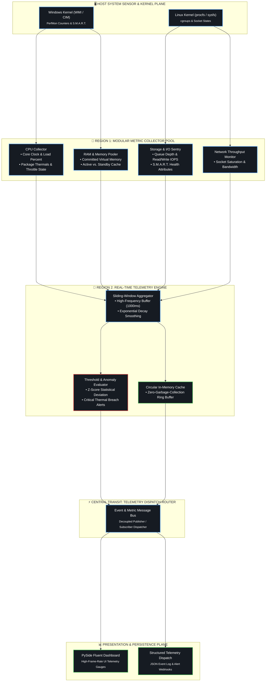

<div align="center">

# 🩺 SysHealth-Pro

### High-Frequency System Diagnostics & Extensible Hardware Metric Architecture
**Python 3.11+ • Domain-Driven Collectors • Real-Time Sensor Telemetry • Cross-Platform (Windows & Linux)**

<p align="center">
  <em>Modular, low-overhead system monitoring engine decoupling hardware sensors from sliding-window metric aggregation.</em>
</p>

<!-- Badges -->
<p align="center">
  <a href="https://www.python.org/downloads/"></a>
  <a href="https://github.com/Anudeep-Adari/SysHealth-Pro"></a>
  <a href="https://coderabbit.ai"></a>
  <a href="LICENSE"></a>
</p>

<p align="center">
  
  
  
</p>

---

</div>

## 📌 Architecture & Metric Ingestion Pipeline



---

## ⚡ Key Architectural Capabilities

* **Decoupled Collector Plugins:** Each hardware subsystem operates in isolation under `collectors/`, allowing custom sensor drivers without altering core analysis logic.
* **Non-Blocking Sampling:** Utilizes asynchronous pooling to maintain high-frequency telemetry without creating thread contention.
* **Minimal Runtime Footprint:** Optimized for continuous background operation with minimal memory overhead (<30MB) and near-zero CPU usage.

---

## 🖥️ Live Telemetry Mockup

```
================================================================================
  SysHealth-Pro Telemetry Monitor ─ [● LIVE CAPTURE]
================================================================================
  HOST: Workstation-01  │  UPTIME: 9d 14h 22m  │  POLL_INTERVAL: 1000ms
--------------------------------------------------------------------------------
  CPU  Usage: 14.2%   │ Base Clock: 3.8 GHz   │ Current: 4.62 GHz  [TEMP: 48°C]
  RAM  Usage: 42.1%   │ Committed: 13.4 GB    │ Total: 32.0 GB
  DISK Activity: 2%   │ Read: 1.2 MB/s        │ Write: 0.4 MB/s   [HEALTH: 100%]
  NET  In: 142 KB/s   │ Out: 48 KB/s          │ Active Connections: 64
================================================================================
```

---

## 🚀 Quickstart & Setup

```bash
# Clone the repository
git clone https://github.com/Anudeep-Adari/SysHealth-Pro.git
cd SysHealth-Pro

# Create virtual environment
python -m venv .venv
source .venv/bin/activate  # On Windows: .venv\Scripts\activate

# Install dependencies
pip install psutil pydantic
```

---

<div align="center">

Crafted with high engineering precision by **[Anudeep Adari](https://github.com/Anudeep-Adari)**  
Continuous AI Code Reviews powered by **CodeRabbit**

</div>

